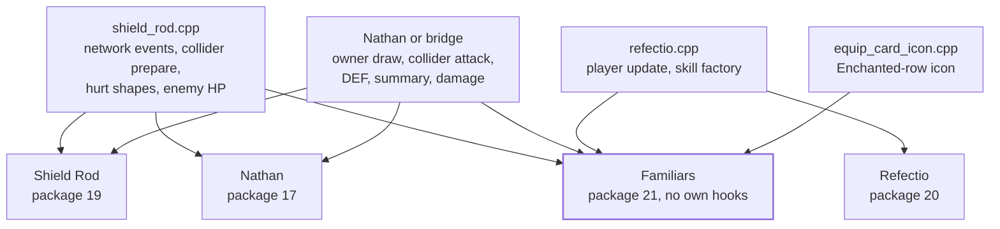

# Harmony of Despair Mods — Integration Reference

Nov 19, 2026 · @Dana

## Overview

Four mods share one patched HarmonyRecomp runtime. Each has its own DLC package, but they also share native hooks, global index ranges, icon sheets and edited base tables. If you add content, read the **Conflict map** section before you choose an index, a package number or a hook.

| Mod | Character | Package | Content ID | Native code | State (2026-11-19) |
| --- | --- | --- | --- | --- | --- |
| Shield Rod + shield spells | Alucard (ID 2) | 19 | `000000000000000000000000000000535200001358` ("SR") | `src/shield_rod.cpp`, `shield_rod_bridge.cpp` | Released as ShieldRodInstaller 1.4.2; 1.5.0 built, not released |
| Familiar cards (Bat, Ghost, Faerie, Demon, Sword) | Alucard (ID 2) | 21 | `000000000000000000000000000000464D00001558` ("FM") | `src/alucard_familiar.cpp`, `equip_card_icon.cpp` | All five work in game; latest exe builds untested |
| Nathan Graves (Circle of the Moon) | New character, ID 12 | 17 | `000000000000000000000000000000000C00001758` | `src/nathan_dss_damage.cpp` (exe), `src/nathan_dss.cpp` (module `dllTest12`) | All 100 DSS pairs have code paths; many await live confirmation |
| Refectio glyph | Shanoa (ID 6) | 20 | `000000000000000000000000000000524600001458` ("RF") | `src/refectio.cpp` | Casts and heals in game; mastery per tick confirmed |

Package 18 (`...4D5000001258`) is the CotM music pack. It touches no code and is only listed here so nobody reuses the number.

**How to read this.** Each mod section lists the same four things, in this order:

1. **Data**: package contents and every base or DLC table it edits.
2. **Native hooks**: every guest function the runtime overrides, and why.
3. **Indexes and memory**: global IDs, tags and guest-memory fields it claims.
4. **Build and install**: the tool, its settings file, and how to uninstall.

Addresses are Xbox 360 guest addresses in the TU2 base image (`sub_8xxxxxxx` in the generated code). `owner` means the player's game object; `player` means the character module's object. All source paths are relative to `.setup/package/src/` (runtime) or `modding/` (tools and settings).

**No game assets ship.** Every tool builds its art, audio and table rows from the user's own files: their HoD install, their SotN USA disc (SLUS\_00067) and their CotM ROM. The only hand-made files are Nathan's two dive-kick poses, his menu portrait and the Enchanted-row card icon.

## Shared infrastructure

All four mods install the same way and hook the game the same way. Learn these mechanics once; every later section assumes them.

### How a package is installed

Each package is one LIVE STFS file, written by `hod_musicpack.py`'s writer (`install_file(..., music=False)`). Installing it means four steps:

1. Copy the STFS file to `<game>/dlc/<content id>`.
2. Add a line `<content id><TAB>packageNN` to `<game>/dlc_packages.txt`.
3. Write its content header to `Documents/harmonyrecomp/0000000000000000/58410A7A/Headers/00000002/<content id>.header`.
4. Copy the file into the setup's DLC folder (`.setup/package/src/assets/dlc`), so a recomp rebuild keeps it.

The recomp unpacks every listed package at start into `Documents/harmonyrecomp/0000000000000000/58410A7A/00000002/<content id>/`. `dlc.cpp` also accepts older filename-only lines in `dlc_packages.txt`.

**Content ID format:** 30 zeros, a 2-byte ASCII tag in hex, the package number as 4 hex digits, then `58`. Example: `'0'*30 + '535200' + '0013' + '58'` is Shield Rod ("SR", package 19).

**First-mounted package wins** for any shared data path. Give every new file a unique name. The one deliberate exception is the item icon sheets (see below).

### How native code is hooked

The runtime is a ReXGlue static recompile. A mod overrides a guest function by defining `REX_EXTERN(sub_XXXXXXXX)` in its own source file; the original stays callable as `__imp__sub_XXXXXXXX`. All overrides in this project call the original, then add behaviour before or after it.

**Only one definition per address can exist in the whole exe.** That is the main integration risk. Where two mods need the same function, one file owns the override and calls the other mod's entry point. Those shared overrides are listed in the Conflict map.

**Same-shard calls bypass overrides.** The generator emits direct calls inside a shard, and LLVM may fold them to the local `__imp__` body. `CMakeLists.txt` rewrites those call sites to `REX_CALL_INDIRECT_FUNC(0x...)` at configure time. If you override a function, check every shard that calls it and add it to the matching rewrite list:

| Shard file (`generated/default/harmonyrecomp_recomp.N.cpp`) | Rewritten calls |
| --- | --- |
| 1 | `82246DF0` |
| 16 | `823D7170`, `823C4C40`, `823C5098`, `823C4EC8` |
| 17 | `823E4AB0`, `8245D9A0`, the five equipment-column draws and `823E0410` |
| 18 | `82412880`, `8245D9A0` |
| 20 | `82451AA8`, `82452658`, `824526D0`, `8244BF10`, `82450658`, `824519C8`, `8244CA98`, `8244FFF8` |
| 21 | `8246D8E8`, `8244CA98`, `8245D9A0` |
| 22 | `824823A0`, `82487EF8` |
| 33 | `825CEFA0`, `825CED10` |

The same edits are kept as `modding/patches/cmakelists-nathan.patch` and `shield-rod-nathan-summon-prepare.patch`.

### Two runtime builds

The CMake option `HARMONYRECOMP_NATHAN` selects one of two exes:

- **ON** (the dev build): adds `src/nathan_dss_damage.cpp`, and `src/nathan_dss.cpp` into module `harmonyrecomp_dllTest12`.
- **OFF** (the distributable Shield Rod runtime): adds `src/shield_rod_bridge.cpp` instead.

Both files define the same five overrides (`82451AA8`, `8245D9A0`, `824476B8`, `824827F0`, `8244BF10`). In the OFF build the bridge only forwards to Shield Rod and the familiars. In the ON build Nathan's versions forward to them as well. Anything you add to one must be added to the other.

`shield_rod.cpp`, `refectio.cpp`, `equip_card_icon.cpp` and `alucard_familiar.cpp` are in both builds.

### Exe and module cannot link each other

Nathan's DSS code in `dllTest12` can't call functions in the exe, and the exe can't call into it. They share `rexruntime.dll` and guest memory, so guest memory is the channel. Example: the exe writes the address of its hurt-shape table (`src/hurt_record_guest.h`, tag `HURT`) into Nathan's player block at +8176 every player update.

### Online co-op rule

A mod effect that runs only on the host is invisible to peers. Every mod here follows the same model, documented in `modding/docs/NATHAN_LESSONS_FROM_SHIELD_ROD.md`:

- **Local test:** `owner+0x930 == 1`. Only the local machine reads input, spends MP and writes the save.
- **Damage:** only the owner's machine applies damage (`8224E700`), so a peer's replay shows hits and numbers without double damage.
- **Sync:** events ride the native spawn-event carrier `8244CA98`, kind 11, sub 1 (replicate only), with a 16-bit signature in r9/r10. No separate network channel.
- **Player list:** `[8291D968]+0x14` is a pointer to six player handles, not an inline array.

### Item icons

The game takes all four icon sheets (`item`, `sub`, `armor`, `weapon`) from the highest-numbered package that ships `data/item/icon/icon<NN>_*.dds` (`82595678`). Today that is package 21, which carries copies of Nathan's sheets plus the familiar card. Shield Rod ships no sheets. Rebuild package 21 whenever an earlier package changes its icons.

### Chest and drop edits

Chest and enemy-drop changes are native table edits, never hooks:

- **Chests:** an entry (u16 category, u16 index, u32 weight) is added to the explicit weighted list of a chest in the stage set file `data/stage/stage00_NN_set[_hard].dat`. The roll `823AA6D8` draws in max(total weight, 10000), so weight 300 is about 3%.
- **Enemy drops:** the item goes in a free slot of the enemy's `EnemyParam` row (slot A +0x1C with rate +0x46, or slot B +0x20 with rate +0x48; rate out of 1000). The Monster Compendium shows them natively, and it has room for only two drops per enemy.

Each tool removes its own old entries first and inserts in a fixed order, so the files come out byte-identical whichever tool runs last. Order inside a list: familiar cards go before Refectio and Nathan's cards; Shield Rod and Refectio go before Nathan's cards, which \`nathan\_card\_drops.py\` always appends last.

Pristine copies of every edited game file are in `modding/originals/` (listed with SHA-256 in `manifest.json`). They are game-derived and must never be distributed.

## Shield Rod (Alucard, package 19)

The Shield Rod revives SotN's cut weapon as a real Alucard weapon, with all 13 SotN shield spells. Hold a shield's button to guard, then newly press the rod's button to cast that shield's spell. The weapon row is data only; the spells, the +5 ATK with a shield and the buffs are native code.

### Data

**Package 19 contents** (`modding/build/shield_rod/contents/`):

| File | What it is |
| --- | --- |
| `000info/package19.dat` | Package marker |
| `data/item/weaponset_dlc19.dat` | One WEPN row, cloned from the base Mace row (row 65) |
| `data/opd/weapon/ar/P_ARSW1B.OPD`, `T_ARSW1B.CSR` | Rod sprite: 60 frames, 6 animations, from SotN `WEAPON0.BIN` slot 7. Palette 15 of the shared club palette `C_ARSW03.COL` |
| `data/text/textres19_{de,en,es,fr,it,ja}.txrc` | Name and description, copied from base text index 68 ("Shield Rod", still in every base language) |

**WEPN row values** (`modding/shield_rod.json`): global index 0xA0, item 0xD3, Alucard only (mask 0x2), ATK 16, DEF 2 (+0x24), icon cell 66, price 25000, rarity 4. Icon cell 66 is HoD's own unused Shield Rod icon in the weapon sheet; the package ships no icon sheets. The sprite path is `ar/P_ARSW%02X.OPD` (`8246CBE0`), so sprite ID 0x1B needs no table.

**Base and DLC files edited outside the package:**

| File | Copies edited | Change |
| --- | --- | --- |
| `data/stage/stage00_03_set_hard.dat` (Chapter 8 Hard, Legion; package 02 `9CF5...`) | Setup DLC source, installed DLC folder | One entry (category 3, index 0xA0, weight 50) in the type-4 boss chest with ranks (0, 208). About 0.5% per chest |
| `data/opd/weapon/ar/P_ARSH00`–`P_ARSH0B.OPD`, `C_ARSH00.COL`, `C_ARSH01.COL` | `assets/` and `.setup/package/src/assets/` | Spell frames added to HoD's existing shield sprites. HoD already holds SotN's cut spell art (Axe Knight: `P_ARSH04` frames 61–67) |
| `data/opd/weapon/ar/T_SF*.CSR`, `T_SRFX00`–`T_SRFX0A.CSR`, `T_SFNOTICE.CSR` | Both asset copies | New texture pages for spell effects and the buff notice |
| `data/sound/SE_SHIELDROD.xsb`, `.xwb` | Both asset copies | New XACT bank rendered from the user's SotN `DRA.BIN` (cues `SE_SR_<sotn id>`). Volume 68, distance curves copied from native sounds |

The asset installer (`tools/install_shield_sotn.py`) checks every file's SHA-256, backs up anything it replaces and records an `install_manifest.json`. Restore with `--restore <backup>/install_manifest.json`.

### Native hooks

All in `src/shield_rod.cpp` unless noted.

| Address | Native role | What the mod does |
| --- | --- | --- |
| `82450658` | Guard start, every frame per owner | Native guard first, then the combo check and cast (Alucard, local, alive) |
| `824519C8` | Physical attack of one weapon | +5 with a shield in the other hand; +20 while the Knight buff runs |
| `824526D0` | INT total | +20 while the Shaman buff runs |
| `8244CA98` | Player spawn event (network carrier) | Replays a remote Shield Rod cast; also calls Nathan's hook and the familiars first (see Conflict map) |
| `824823A0` | Collider prepare phase | Submits colliders tagged `SRKN` (and familiar `FMLG`) here; also calls Nathan's prepare hook |
| `823C4C40` | Collision shape registration | Takes `collision_lock`; captures enemy hurt shapes for targeting; feeds the familiars' target cache; observes the native guard box |
| `823C5098` | Collision list traversal | Takes `collision_lock` around the native call |
| `823C4EC8` | Collision pair filter | Rejects invalid or sentinel request addresses (fixes a Medusa-cast crash) |
| `82246DF0` | Enemy HP transaction | Observes a real HP drop from a tagged hit: Alucard Shield recovery, familiar soul steal |
| `825CEFA0`, `825CED10` | XACT bank creation (XSB, XWB) | Logs the result for the mod's own banks only |
| `82451AA8` | Physical DEF | +20 during the Leather buff. Override lives in `nathan_dss_damage.cpp` (ON) or `shield_rod_bridge.cpp` (OFF) |
| `8245D9A0` | Status/equipment summary | Rod ATK and buff values on menus; half fire/thunder/dark damage while Herald/Goddess resist. Same shared owner |
| `824476B8` | Owner draw | Draws detached spell art once per owner, after body and afterimage draws. Same shared owner |
| `824827F0` | Collider attack phase | Routes `SRKN` colliders to `shield_rod::ResolveHit`. Same shared owner |
| `8244BF10` | Incoming damage/heal | Alucard Shield invulnerability window. Same shared owner |

### Indexes and memory

- **WEPN 0xA0 / item 0xD3.** Nathan owns WEPN 0x91–0x9F. Item ID = WEPN global index + 0x33.
- **Collider tag** `0x53524B4E` ("SRKN") at collider +0x190, owner at +0x194. Colliders are the native attack-rectangle recipe; `ResolveHit` submits once, expires after 0.12 s and asks `823C4E00` (mask 0x40000000 | 0x20 | 2) whether an enemy was touched.
- **Network event:** `8244CA98(owner, shield item, kind 11, sub 1, slot 0, 0, r9 0x5352 "SR", r10 0x4F44 "OD")`. Peers replay the spell without MP; damage still applies only on the caster's machine.
- **Host state:** `states[8]` per owner under a recursive mutex. Buffs last 4096 frames and reach local players within 320×240 of the caster.
- **Player fields read:** hands = `owner+0x9C8` slots 0 (X) and 1 (Y); held buttons `*(player+0x2C0)` (X 0x20, Y 0x40); guard slot `player+0x2F0`; MP float `stats+8` with `stats = player+88`; body centre `owner+0x8EC/0x8F0`.
- **Floors:** use the push-out queries `823C2D80` (floor), `823C2468`/`823C2720` (walls), `823C29C8` (ceiling). `823C2340` only reports tile bit 0x08 and never sees floors.

### Spell values

MP and power come from SotN's hidden combo rows 0xCB–0xD7, generated into `src/shield_rod_balance.h` by `shield_rod.py header`. Damage uses HoD's magic rule P + (P/64 + 0.25) × INT.

| Shield (item) | MP | Power | Effect |
| --- | --- | --- | --- |
| Leather (0x9A) | 10 | 0 | +20 DEF |
| Knight (0x98) | 10 | 0 | +20 ATK |
| Iron (0x97) | 20 | 40 | Two sword tracks |
| Axe Knight (0x94) | 20 | 20 | Floor-walking knight, axe swing |
| Herald (0x90) | 10 | 0 | Fire, then thunder resistance |
| Dark (0x95) | 30 | 30 | Screen blast and 32 rising rocks |
| Goddess (0x91) | 40 | 0 | Light rain, dark resistance |
| Shaman (0x92) | 10 | 0 | Eight stars, +20 INT |
| Medusa (0x99) | 30 | 25 | Two petrifying beams at the nearest enemy |
| Skull (0x93) | 40 | 100 | Skull and beam |
| Fire (0x96) | 50 | 70 | Three fire dragons (element 0x8000) |
| Alucard (0x8F) | 20 | 30 | Orbiting shield; drains 1 MP per 16 guard ticks; contact heals 8 HP + 1 MP |
| Alucart (0x9B) | 10 | 0 | Intro only, as in SotN |

### Build and install

```
python modding/tools/shield_rod.py --disc <SotN .cue>   # once
python modding/tools/shield_rod.py --validate
python modding/tools/shield_rod.py install              # package + Chapter 8 chest
python modding/tools/shield_rod.py header               # regenerate shield_rod_balance.h
python modding/tools/install_shield_sotn.py             # spell art, sound bank, exe
```

Players use `ShieldRodInstaller` (`modding/standalone/shield_rod/`), which ships the Nathan-OFF runtime as a bsdiff patch, finds Chapter 8 itself and has a byte-exact uninstall. Version 1.5.0 also installs the familiars and Refectio (it requires Chapters 7, 8 and 11); it is built but not released or tested on the fixture.

## Familiars (Alucard, package 21)

Five SotN familiar cards (Bat, Ghost, Faerie, Demon, Sword) go in Alucard's Enchanted row and summon a familiar while equipped. The cards are native soul rows; the familiars themselves are native code with SotN-derived art and sound. **The familiar code defines no overrides of its own.** It runs only because Shield Rod, Refectio, Nathan or the bridge call into it, so it cannot ship without those sources.

### Data

**Package 21 contents** (`modding/build/alucard_familiars/contents/`):

| File | What it is |
| --- | --- |
| `000info/package21.dat` | Package marker |
| `data/item/soulset_dlc21.dat` | Five SOUL rows, global indexes 111–115 |
| `data/text/textres21_{de,en,es,fr,it,ja}.txrc` | Card names and descriptions (skill groups 13 and 14) |
| `data/item/icon/icon21_{item,sub,armor,weapon}.dds` | All four icon sheets: copies of the highest other package's sheets (Nathan's 17) plus the SotN card icon in sub-sheet cell 81 |

**Soul row values:** Alucard only (mask 0x2), soul type 3 (Enchanted row 13, the way Nathan's attribute cards are placed), effect selector 0 (no native passive), icon 81, 9 copy tiers, chest rank and weight 0. Copies owned scale each familiar's power and cooldown from 1 to 9 cards.

**Base and DLC files edited outside the package:**

| File | Copies edited | Change |
| --- | --- | --- |
| `data/player/player_default.def` | `assets/` and `.setup/package/src/assets/` | Alucard's equipment-row mask at record +0x2C: 0x4FFF → 0x6FFF (turns on row 13, Enchanted). Row 12 (RB) stays off |
| `data/opd/player/aru/P_ARU_00.OPD` | Both asset copies | Alucard's body sprite: familiar frames appended (Ghost 284–303, orb 304, Faerie 335–385, Bat/Demon/Sword on packed pages). Its palette reference is switched to `C_ARFM.COL` |
| `data/opd/player/aru/C_ARFM.COL` (new) | Both asset copies | Alucard's original palettes plus servant colours in vacant slots, so weapons keep their own palette |
| `data/opd/player/aru/T_ARFM01`–`T_ARFM04.CSR` (new) | Both asset copies | Familiar texture pages. Names up to `T_ARFM06` are reserved |
| `data/opd/menu/p_ui_equip0.opd`, `f_ui_equip1a.csr` | Both asset copies | Card icon for the Enchanted row: frames 180 (palette 6) and 181 (palette 7, dimmed), pixels in the page's empty strip rows 96–127. User-drawn art |
| `data/sound/SE_FAMILIAR.xsb`, `.xwb` (new) | Both asset copies | 13 cues `SE_FM_<sotn id>` from the user's SotN disc; voices in XACT category 30 |
| `data/enemy/EnemyParam.dat` (base) | Both asset copies | Card drops at 2.5% (rate 25 of 1000): Bat card on `armc02` (Bat), Ghost card on `sf_bor` (Ghost), Demon card on `imp` (Imp) |
| `data/stage/stage00_04_set_hard.dat` (Chapter 7 Hard) | Setup DLC source, installed DLC folder | Faerie card (category 6, soul 113, weight 300) in all 5 purple (type 5) chests |
| `data/stage/stage00_03_set_hard.dat` (Chapter 8 Hard) | Same | Sword card (soul 115, weight 300) in all 4 purple chests |

Older builds put the Ghost's palettes in both `C_X2BASE.COL` copies (`aru/` and `weapon/ar/`); uninstall restores those from `modding/originals`. `modding/data/alucard_familiar_drop_originals.json` records every EnemyParam slot the tool has ever replaced, so `drops-remove` is exact.

### Native hooks (borrowed)

The familiar runtime is `src/alucard_familiar.cpp`. Every entry point is called from another file's override:

| Entry point | Called from | When |
| --- | --- | --- |
| `Frame` | `8244FFF8` override in `refectio.cpp` | Every player update, every machine, with frame seconds |
| `Draw` | `824476B8` override (`nathan_dss_damage.cpp` or `shield_rod_bridge.cpp`) | After Alucard's body draw |
| `PrepareHit` | `824823A0` override in `shield_rod.cpp` | Collision prepare phase for `FMLG` colliders |
| `ResolveHit` | `824827F0` override (Nathan or bridge) | Collision attack phase for `FMLG` colliders |
| `ObserveHurtShape` | `823C4C40` override in `shield_rod.cpp` | Every hurt-shape registration, under `collision_lock` |
| `Landed` | `82246DF0` override in `shield_rod.cpp` | An enemy really lost HP to a familiar hit (Ghost soul steal) |
| `SpawnEvent` | `8244CA98` override in `shield_rod.cpp` | Remote Sword Brothers casts |

`src/equip_card_icon.cpp` owns six overrides of its own for the card icon: `823E0410` (row slot → icon frame) and the five equipment-column draws `823E6958`, `823EA810`, `823ED418`, `823F46A8`, `823F47C8`. During a column draw it sets the screen's "current character is Soma" byte (+216/+456/+216/+224/+224) for character IDs 2 and 12, so slot 3 is drawn, and answers frames 180/181 for that slot.

**Native functions it calls:** `823D2648` (draw a frame), `82484180` (area submit), `823C4E00` (overlap query), `8244DCA0` (status cure, the Remedy path), `82487EF8` (skill factory, for Charlotte's Heal), `82533878` (spell power), `82239218` (positional sound), `82590680`/`82590878` (sound bank queue).

### Indexes and memory

- **Souls 111–115, items 0x6E2–0x6E6** (soul item = 0x673 + index). Soul ranges: base 0–52, DLC 53–89, Nathan 90–110.
- **Collider tag** `0x464D4C47` ("FMLG") at +0x190. Collider vtable +0x1C = `824823A0` (prepare), +0x24 = `824827F0` (attack), the same as Shield Rod's.
- **Repeat-hit key** `0xFB` with a 0.25 s window in the gate `8224E4E8`, so familiar hits and Alucard's weapon don't block each other.
- **Target cache:** fed from `823C4C40` registrations, fresh for 100 ms. A hurt record is `(flags & 0x18) && !(flags & 2)`. Guard boxes (0x10) rank behind every other enemy box.
- **Draw:** render list 5 at depth 40000, unless Alucard's body is in a zoomed list (7–10).
- **Copies owned:** save model `82223348`, save at +0x1018, inventory byte at +0x3E8 + item, copies = byte >> 4.
- **Network event (Sword Brothers only):** kind 11, sub 1, tags "SB" "RO", id 0x6E6. The other familiars need no events: every machine runs every Alucard's familiar from equipment word 13, and only the owner's machine applies damage or heals.

### What each familiar does

| Card (item) | Behaviour | Values (1 → 9 cards) |
| --- | --- | --- |
| Bat (0x6E2) | Dives at the first enemy in its lane, then pulls up | Power 8 → 30, cooldown 50 ticks |
| Ghost (0x6E3) | Clings to the target and attacks with SotN's orb ring; soul steal from 8 cards | Power 10 → 40; SotN delay table × 0.5, minimum 42 ticks |
| Faerie (0x6E4) | Cures poison, curse and stone; casts Charlotte's Heal below 33% HP. Never attacks or uses items | Cure cooldown 12 → 4 s, heal cooldown 45 → 20 s |
| Demon (0x6E5) | Casts fire, ice and lightning in turn | Power 14 → 48, cooldown 86 ticks |
| Sword (0x6E6) | Two rotations, a rush from 7 cards, upgraded art at 9. **Sword Brothers** command: ↓ ↘ → ↗ ↑ ↓ then X or Y, 30 MP | Power 12 → 44, cooldown 66 ticks; Sword Brothers 20 → 60 |

All damage uses HoD's spell rule P + (P/64 + 0.25) × INT. Every value lives in `modding/alucard_familiars.json` and is generated into `src/alucard_familiar_balance.h`.

### Build and install

```
python modding/tools/alucard_familiars.py install   # package, row mask, art, sound
python modding/tools/alucard_familiars.py drops     # EnemyParam and chest edits
python modding/tools/alucard_familiars.py header    # after editing the JSON
python modding/tools/rebuild_recomp.py ON
python modding/tools/install_nathan_dss.py --source
```

`uninstall` removes the package and restores the row mask and art; `drops-remove` restores the drop tables. `grant --copies N --cards ...` writes test cards into the save (backed up). Package 21 must be rebuilt whenever Nathan's icon sheets change.

## Nathan Graves (character ID 12, package 17)

Nathan is a 12th playable character built on a rebased copy of Simon (8-bit)'s code module, with CotM's DSS card system: 20 cards and all 100 pairs. He is the largest mod and the one that edits the most base tables, because no base or DLC item lists character 12. The authoritative build record is `modding/docs/Nathan_DLC_Technical_Report.html`; open work is in `modding/NATHAN_RELEASE_CHECKLIST.md`.

### Data

**Package 17 contents** (`.setup/package/src/mods/000000000000000000000000000000000C00001758/`):

| File | What it is |
| --- | --- |
| `data/player/dllTest12.dll` | Simon's `dllSimon.dll` rebased to 0x836C0000 (`xexrebase.py`), then patched in place (`data/nathan_module_patches.json`): a new `.nathan` code section, ID 12 in vtable entries 143/144, sprite path `nathan/p_nathan.opd`, voice bank paths, motion-table bytes |
| `data/player/player_test12.def` | Character record: ID 12 at +0x04, internal name `Test12` at +0x6C (must match the module name), menu sprite path at +0x7C, DSS cards as the collection list (mode 1) |
| `data/item/weaponset_dlc17.dat` | Hunter Whip (WEPN 0x91) and the DSS elemental whips from 0x92; Nathan mask 0x800 |
| `data/item/soulset_dlc17.dat` | 20 card SOUL rows (global souls 90–110; Mercury is item 0x6CD): 10 Action Cards in the RB row, 10 Attribute Cards in the Enchanted row |
| `data/opd/player/nathan/` (98 files) | Body sprite, DSS layers and effects, built from the CotM ROM |
| `data/opd/weapon/wp/p_wpf0`–`p_wpf2.opd`, `f_wpf0.csr`, `c_wpf0.col` | Invisible whip sprites F0–F2, whose hitboxes match the drawn whip. DSS whip effects use sprite IDs from 0xF3 |
| `data/menu/chara_SEL11`, `g_face11`, `ui_chara11`, `ui_face11.dds` | Menu art (art index = ID − 1). The portrait is user-made |
| `data/item/icon/icon17_*.dds` | All four icon sheets; the CotM card-drop icon is in sub-sheet cell 80. Package 21 now overrides these sheets |
| `data/sound/VX_NATHN`, `VXJ_NATHN` (.xsb/.xwb) | Voice banks rendered from CotM (about 5.1 MB of the 16 MB sound heap) |
| `data/text/textres17_*.txrc` | Names, card rules and pair texts (text IDs: high byte = package × 4) |

**Base and DLC tables edited outside the package.** These are the edits most likely to collide with other mods:

| File | Where | Change | Tool |
| --- | --- | --- | --- |
| `data/player/guardset.dat` | Base, plus DLC 02, 03, 04, 07 `guardset_dlcNN.dat` | Adds Nathan's permission bit 0x800 to hunter armour and accessories | `nathan_equipment_access.py` |
| `data/player/subweaponset.dat` | Base, plus DLC 02, 04 `subweaponset_dlcNN.dat` | Same, for sub-weapons | `nathan_equipment_access.py` |
| `data/player/martialartsset.dat` (base only) | Base | Tackle appended as Martial Art 11. The game only looks Martial Arts up in the base table (`8246E8E8`), so a DLC file would never be found | `nathan_card_drops.py` |
| `data/text/textres_{de,en,es,fr,it,ja}.txrc` (base) | Base | Tackle name and description | `nathan_card_drops.py` |
| `data/enemy/EnemyParam.dat` (base), `EnemyParam07.dat` (DLC 07) | Base, Chapter 11 | Card drops in free item slots, 2.5% unless noted (Cockatrice 0.5%) | `nathan_card_drops.py` |
| `stage00_00/01/02/05/07/08_set_hard.dat` (base); `stage00_03` (DLC 02), `stage00_04` (DLC 01), `stage00_09` (DLC 03), `stage00_10` (DLC 04), `stage00_11` (DLC 07) | Hard boss chests | Saturn, Unicorn, Uranus, Black Dog and Pluto cards, appended last in each list | `nathan_card_drops.py` |

Base files are edited in `assets/` and in the setup's source copy; DLC files in the setup's DLC sources and the installed DLC folder. The tools refuse tables that differ from the expected originals, strip their own entries before re-adding them, and back up what they replace.

**Card sources:**

| Card | Source | Card | Source |
| --- | --- | --- | --- |
| Mercury | Skeleton; Hellmont (Ch. 11) | Salamander | Bone Pillar |
| Venus | Une | Serpent | Frozen Shade |
| Jupiter | Disc Armor | Mandragora | Man-eating Plant |
| Mars | Gurkha Master | Golem | Treant |
| Diana | Skeleton Gunman | Cockatrice | Medusa Head (0.5%) |
| Apollo | Fire Demon | Manticore | Glasya Labolas |
| Neptune | Sea Demon | Griffin | Harpy |
| Saturn | Hard boss chest, Ch. 2 and 9 | Thunderbird | Thunder Demon |
| Uranus | Hard boss chest, Ch. 4 and 8 | Unicorn | Hard boss chest, Ch. 3 and 7 |
| Pluto | Hard boss chest, Ch. 6 and 10 | Black Dog | Hard boss chest, Ch. 5 and 11 |

### Native hooks: executable (`src/nathan_dss_damage.cpp`, 23 overrides)

These exist only in the Nathan-ON build. Each one checks Nathan's player vtable before changing anything, so other characters keep native behaviour.

| Address | Native role | What Nathan adds |
| --- | --- | --- |
| `82451AA8` | Physical DEF | DSS DEF bonuses; also calls `shield_rod::DefenseBonus` |
| `8245D9A0` | Status/equipment summary | DSS values on menus; also calls `shield_rod::Summary` |
| `82452658` | Attack value getter | Multiplies by the active pair's attack bonus |
| `8244BF10` | Incoming damage/heal | Neptune 50% resistances, Jupiter shields, single-use DSS heals; calls `shield_rod::Incoming` first |
| `8245BCA8`, `8244E3C8` | Heart pickup, MP gain | Doubles heart MP while the Venus pair with attribute 5 runs (heart path only) |
| `8246C408`, `8246F5C0` | Weapon setup, weapon hit flags | Hunter Whip (0x91) only: DSS elemental bits on the live whip hit object |
| `824699B8`, `82469D18`, `823D31C8`, `823D4098` | Weapon animation start and collision query | Remaps whip clips 2–31 to the DSS whip geometry; clips 0/1 stay native |
| `823D2648` | Draw one OPD frame | DSS palettes, effect layers, echoes and overlays on Nathan's sprites |
| `823D7170` | Sprite palette lookup | Nathan's palette for player-list and menu portraits (resource FNV-1 0x854D90C4) |
| `824476B8` | Owner draw | Palette scope for Nathan's body; then `shield_rod::Draw` and `alucard_familiar::Draw` |
| `82412880` | Character Select preview | Nathan's preview only |
| `824827F0` | Collider attack phase | Summon and pool colliders; routes `SRKN` to Shield Rod and `FMLG` to the familiars |
| `82484918` | Hit notification to the attacker | DSS on-hit bookkeeping; guarded against non-player attackers (Chapter 7 boulder crash) |
| `823C90C0` | Item description text | Card text from the equipped loadout |
| `823E4AB0` | Menu description footer | "LV. n" and "MP n" on Attribute Cards |
| `823ED2E0` | Martial Arts page | Input row for the Tackle (the native table covers base arts only) |
| `8245D008` | Mastery award | +20% of each sub-weapon mastery award for Nathan |
| `8246D8E8` | Generic table row lookup | Per-Nathan discounted copy of a sub-weapon row (DSS cost changes) |

Nathan also registers two hooks inside Shield Rod's file at start-up: `SetSpawnEventHook(ReceiveNathanEvent)` (online events) and `SetPrepareHitHook(PrepareSummonParticle)` (collider prepare phase).

### Native hooks: module (`src/nathan_dss.cpp`, 16 overrides in `dllTest12`)

| Address | What it does |
| --- | --- |
| `836D0000` | Player allocation: enlarges it to 8192 bytes (the player extension) |
| `836D00F8` | Level/life init: MP regeneration 1 → 2 MP/s (`mp_regen`) |
| `836D11B8` | Motion-table setup: Nathan's animations |
| `836D1FC8` | Player update: DSS, Card Swap, starting items, the online event queue |
| `836DBEF8` | Whip swing start: records paid and big swings (local only) |
| `836D4638` | Entry 268: answers Simon's VK-shot command as Martial Art 11 |
| `836D16C8`, `836D17A8`, `836D18B8` | State 37 enter/update/exit: the Tackle dash |
| `836DC9A0`, `836D7C50` | The two readers of boots speed: Pluto + Griffin and Jupiter + Cockatrice speed |
| `836D3670`, `836D36B8`, `836D3790` | STR, INT and LCK getters: Venus and Mercury bonuses |
| `836D1358` | Voice bank paths, kept in the player extension |
| `836D1378` | Suppresses Simon's inherited damage/death voice |

### Indexes and memory

- **Character ID 12.** IDs 12–15 are free. Entry 144 is the real ID (save record, weapon sprite slot, item permission); answering 10 made him share Simon's save record.
- **Permission bit 0x800** (bit ID − 1) on every item he may use.
- **WEPN 0x91–0x9F**, weapon sprite IDs 0xF0 and up, **souls 90–110**, Martial Art 11, sub-sheet icon cell 80.
- **Player extension (8192 bytes):** projectile pool at +1728 (16 slots), pair level at +1580, network queue `kNet` at +7744 (104 bytes, 16 events), hurt-table pointer at +8176 (written by the exe).
- **Network events:** kind 11, sub 1, r9/r10 "NA" "TH", the event in the 16-bit id (on, off, cast, swing, attack, sub-weapon). Copies replay under `ReplayScope`: no MP, no self-heal, no save access.
- **Card Swap** draws in render list 6 at depth 60000, above all terrain.
- **Facing:** read `player+0x250` (1 = left); the sprite's mirror flag lags one frame.

### Build and install

```
python modding/tools/setup_nathan.py --rom <CotM ROM> --agbplay <agbplay-cli.exe>   # first install
python modding/tools/build_nathan.py --assets --install                             # later rebuilds
python modding/tools/install_nathan_dss.py --restore <backup>                       # undo one install
```

`setup_nathan.py` checks HarmonyRecomp v0.6.0 and Simon's DLC, backs up saves, applies `modding/patches/build-py-mods-folder.patch` and `cmakelists-nathan.patch`, extracts the ROM, builds the package and runs the recomp's `build.py --force-codegen` once. `build_nathan.py` runs about 16,600 native checks (`verify_nathan_dss.py`) before building. Run `overlap.py` on any new file to catch shared-path collisions.

## Refectio glyph (Shanoa, package 20)

Refectio is a Shanoa glyph that heals her over time: 20 ticks, one per second, self only. The glyph row is native data, so the glyph menu, MP cost, cast motion, permission and chest drops are all native. Two small overrides supply the heal, because natively a DLC glyph with no registered shot module creates nothing.

### Data

**Package 20 contents** (`modding/build/refectio/contents/`):

| File | What it is |
| --- | --- |
| `000info/package20.dat` | Package marker |
| `data/item/glyphset_dlc20.dat` | One GLYP row, cloned from Luminatio's row; global glyph index 8 |
| `data/text/textres20_{de,en,es,fr,it,ja}.txrc` | Name and description (skill groups 13 and 14) |

**Glyph row values** (`modding/refectio.json`; offsets from file +16): power −60 at level 1 to −150 at max (+0x20/+0x22; negative heals), MP 40 (+0x28), Shanoa only (mask 0x20 at +0x2E), icon 26 (+0x32, the green book every glyph uses), Luminatio's cast motion 111 (+0x38), rarity 4.

**Stage files edited outside the package** (Chapter 7, Astarte, DLC package 01 `36DA...`):

| File | Chests | Entry |
| --- | --- | --- |
| `stage00_04_set.dat` (Normal) | 5 purple (type 5), 1 boss (type 4) | Category 9 (glyph), index 8; weight 300 purple, 1000 boss |
| `stage00_04_set_hard.dat` (Hard) | Same | Same |

The chest roll filters by permission, so only Shanoa receives it. Weight 300 is about 3% per purple chest; 1000 is about 10% per boss chest. Both files are edited in the setup's DLC sources, `assets/dlc` and the installed DLC folder.

### Native hooks (`src/refectio.cpp`)

| Address | Native role | What the mod does |
| --- | --- | --- |
| `82487EF8` | Skill factory (kind, global index, owner handle, position, …, level − 1 in r9) | For kind 3 (glyph), index 8 only: starts the regen and returns 0, as natively. Every other call passes through |
| `8244FFF8` | Player update with frame seconds in f1 | Native update, then pays the next heal tick. **Also calls `alucard_familiar::Frame`**, so this override is the familiars' only update |

CMake routes both through the indirect-call table: `82487EF8` in shard 22 (its service entry `824881C8` tail-calls it) and `8244FFF8` in shard 20.

**How the heal works:**

1. The total comes from the game's own spell formula, `82533878(kind, index, handle, level)`: L1 + (Lmax − L1) × level/8, then + (P/64 + 0.25) × INT. These are the same rules as Charlotte's Heal.
2. The total is split into 20 whole-HP ticks: floor(T×k/n) − floor(T×(k−1)/n).
3. Each tick shows the native green recovery number (`82454000`) and awards one glyph mastery point (`8245D008(handle, 3, 8)`), because a heal has no enemy hit.
4. Recasting restarts the regen; it does not stack. It ends on death or stage exit.

**Retry guard:** when the cast comes from the hand-item launcher (`8246FB18` → `824881C8` → `82487EF8`, return address `8246FC40`), `r6` is launcher + 0x48. The mod sets the launcher's "fired" flag at +0x9C on the first call, so one launcher starts the regen only once.

**Online co-op:** only the caster's machine heals (`owner+0x930 == 1`). HoD syncs HP from there, as it does for Charlotte's Heal, so no network event is needed.

### Indexes and memory

- **Glyph index 8, item 0x815** (glyph items start at 0x80D, `821D4878`). Base glyphs are 0–4; DLC glyphs are Globus 5 (package 02), Acerbatus 6 (package 03), Luminatio 7 (package 07).
- Chest entry (category 9, index 8).
- Host state per owner, cleared when the player object goes away.

### Build and install

```
python modding/tools/refectio.py install     # package + Chapter 7 chests
python modding/tools/refectio.py header      # regenerate src/refectio_balance.h
python modding/tools/refectio.py verify
python modding/tools/refectio.py uninstall   # chest entries and package
```

`chests --test-weight 9000` boosts the chests for testing; run `chests` again to restore.

## Conflict map

Ten guest functions are overridden once and shared by several mods, 16 kinds of index or tag are claimed, and four game files are edited by more than one tool. Check all three lists before adding anything.

### Shared overrides

To hook one of these, add a call inside the existing override. A second `REX_EXTERN` for the same address will not link.

**The familiars run only through overrides owned by other files.** An arrow means an override in the file above calls into the mod below.



Removing Shield Rod's or Refectio's source file silently disables the familiars, and the Nathan-or-bridge arrow into Nathan exists only in the ON build.

| Address | Owner file | Calls, in order |
| --- | --- | --- |
| `8244CA98` spawn event | `shield_rod.cpp` | Nathan's `ReceiveNathanEvent` → `alucard_familiar::SpawnEvent` → Shield Rod replay → native |
| `824823A0` collider prepare | `shield_rod.cpp` | Nathan's `PrepareSummonParticle` (may consume the call) → `SRKN` → `FMLG` → native |
| `823C4C40` shape registration | `shield_rod.cpp` | Native under `collision_lock` → Shield Rod target capture → `alucard_familiar::ObserveHurtShape` → guard observer |
| `82246DF0` enemy HP transaction | `shield_rod.cpp` | Native → `alucard_familiar::Landed` or Shield Rod `Recover` |
| `8244FFF8` player update | `refectio.cpp` | Native → `refectio::Frame` → `alucard_familiar::Frame` |
| `824476B8` owner draw | `nathan_dss_damage.cpp` / `shield_rod_bridge.cpp` | Native (Nathan palette scope in ON) → `shield_rod::Draw` → `alucard_familiar::Draw` |
| `824827F0` collider attack | Same pair | `SRKN` → `shield_rod::ResolveHit`; `FMLG` → `alucard_familiar::ResolveHit`; Nathan summons (ON); else native |
| `82451AA8` DEF, `8245D9A0` summary | Same pair | Native → Nathan (ON) → Shield Rod |
| `8244BF10` incoming damage | Same pair | `shield_rod::Incoming` (may cancel) → Nathan (ON) → native |

Any other mod that touches collision lists from its own code must take `collision_lock` (or go through `823C4C40`/`823C5098`); enemies register shapes on several threads.

### Claimed indexes, IDs and tags

| Resource | Nathan | Shield Rod | Familiars | Refectio | Next free |
| --- | --- | --- | --- | --- | --- |
| Package number | 17 | 19 | 21 | 20 | 23 (18 is the music pack; 22 is the Poison Worm test package, test install only) |
| Content ID tag | `0C00` | `SR` | `FM` | `RF` | Pick a new 2-byte tag (`PW` is the Poison Worm test package) |
| Character ID | 12 | – | – | – | 13–15 |
| WEPN global index | 0x91–0x9F | 0xA0 | – | – | 0xA1 |
| Soul global index | 90–110 | – | 111–115 | – | 116 (items end before 0x73B) |
| Glyph global index | – | – | – | 8 | 9 |
| Martial Art index | 11 | – | – | – | 12 |
| Sub icon cell | 80 | – | 81 | – | 82 |
| Weapon sprite ID | `wp/p_wpF0`–`F2`, effects 0xF3+ | `ar/P_ARSW1B` | – | – | Check `overlap.py` |
| Collider tag (+0x190) | Own summon check | `SRKN` 0x53524B4E | `FMLG` 0x464D4C47 | – | New 4-byte tag |
| Network r9/r10 tags | "NA" "TH" | "SR" "OD" | "SB" "RO" | None | New pair |
| Sound bank | `VX_NATHN`, `VXJ_NATHN` | `SE_SHIELDROD` | `SE_FAMILIAR` | – | Unique name |
| Render list / depth | Card Swap list 6, 60000 | Owner's list | List 5, 40000 | – | – |
| Repeat-hit key | – | – | 0xFB | – | – |
| Menu frames (`p_ui_equip0`) | – | – | 180, 181 | – | 182 |

### Files more than one mod edits

| File | Edited by | What to watch |
| --- | --- | --- |
| `stage00_03_set_hard.dat` (Ch. 8 Hard) | Shield Rod (boss chest), Familiars (Sword, purple chests), Nathan (Uranus, boss chest) | Entry order is fixed; re-run every tool's verify after any edit |
| `stage00_04_set_hard.dat` (Ch. 7 Hard) | Refectio (purple + boss), Familiars (Faerie, purple), Nathan (Unicorn, boss) | Same |
| `stage00_04_set.dat` (Ch. 7 Normal) | Refectio | – |
| `EnemyParam.dat` (base) | Nathan (cards), Familiars (Bat, Ghost, Demon cards) | Two drop slots per enemy, and the Compendium shows only two |
| `data/item/icon/icon*_*.dds` | Nathan (17) and Familiars (21) | The highest package wins all four sheets; rebuild 21 after 17 changes |
| `player_default.def` (base) | Familiars (Alucard row mask) | Other characters' records untouched |
| Base `textres_*.txrc` | Nathan (Tackle text) | Six languages, both asset copies |
| `guardset.dat`, `subweaponset.dat`, `martialartsset.dat` | Nathan | Base tables, plus DLC 02/03/04/07 gear tables |
| `aru/P_ARU_00.OPD`, `aru/C_ARFM.COL` | Familiars | Any change to Alucard's body sprite must keep frames 284+ and the palette reference |
| `weapon/ar/P_ARSH00`–`0B.OPD`, `C_ARSH00/01.COL` | Shield Rod | Spell frames appended to every shield sprite |
| `dlc_packages.txt` | Every installer | One line per package |
| 16 MB sound heap (`822217DC`) | Nathan, Shield Rod, Familiars, music packs | Banks over the largest free block are refused silently |

### Rules for new mods

1. Prefer native table edits over hooks whenever a table can express the change.
2. Give every file a unique path; run `modding/tools/overlap.py`.
3. Add enemy drops through EnemyParam slots so the Compendium lists them, and never on an enemy that already has two drops.
4. Ship no game assets. Extract from the user's own discs and ROMs at build time.
5. Design effects as "local machine decides, peers replay", over `8244CA98` kind 11.
6. Strip your own entries before re-adding them, insert in a fixed order, and keep pristine originals for uninstall.

## Known issues and open questions

Nothing below blocks normal play of the confirmed features, but each one matters if you build on that area.

### Across all mods

- **HarmonyRecomp v0.6.0 only.** The setup refuses other versions. Its installer deletes `.setup/package` and the toolchain: re-extract from `.setup/downloads` and re-apply both patches in `modding/patches/` before rebuilding.
- **Two builds, one set of shared overrides.** Any change to an override in `nathan_dss_damage.cpp` that serves another mod must be mirrored in `shield_rod_bridge.cpp`, and the reverse.
- **Sound heap.** A live crash on 2026-11-17 (`logs/crash_20261117_043344_*`) read a zeroed heap link while loading an XSB. It is not fixed and not attributed to any mod. Real 48 kHz music would need the 16 MB heap enlarged (`822217D0`); not done.
- **Mismatched builds online.** The lobby does not reject players with a different build or DLC set. A player without Nathan sees an Axe Armor.

### Shield Rod

- Installer 1.5.0 (adds familiars and Refectio) is built but not tested on the fixture or released. November 18 runtime changes (hit areas, Ghost `Landed` hook, sound RPC/category/volume) postdate it.
- Buffs for allies (fixed in 1.4.1) are untested in game: ally damage reduction and the allies' status screen.
- Mablung Sword can also cast shield spells in SotN; not added.

### Familiars

- Latest exe builds are untested: the collider vtable fix (+0x1C prepare, +0x24 attack) was built while the game was open and is waiting to install.
- Draw order: the Ghost drew above one enemy and behind another. Familiars now draw in list 5; not yet confirmed in game.
- Online co-op is untested. Hurt shapes are re-created every frame, so "immune shape" learning keyed on shape address is unreliable.
- Package 21 owns the icon sheets. A later package that ships sheets will hide the familiar card icon.

### Nathan

- Most of the 100 DSS pairs still need a play check (`NATHAN_RELEASE_CHECKLIST.md`, sections 1–2). Online DSS is harness-tested only.
- `FindDssTarget` in `dllTest12` reads the exe's hurt table through guest memory; when that is missing it falls back to walking collision lists without the lock.
- Nathan's `SolidTerrain` uses `823C2340`, which never sees floors, so his projectiles may pass through floors.
- Pair descriptions (100) and the Card Swap text are English in every language. Credits and licence are placeholders.
- `VX_NATHN` takes about 5.1 MB of the sound heap and may starve music packs; not checked.

### Refectio

- Glyph index 8 assumes DLC glyphs 5–7 are mounted. A game without Chapter 9 (Acerbatus, glyph 6) is untested; installer 1.5.0 requires Chapters 7, 8 and 11.
- Chest weights (300 purple, 1000 boss) were chosen during development, not by playtesting.
